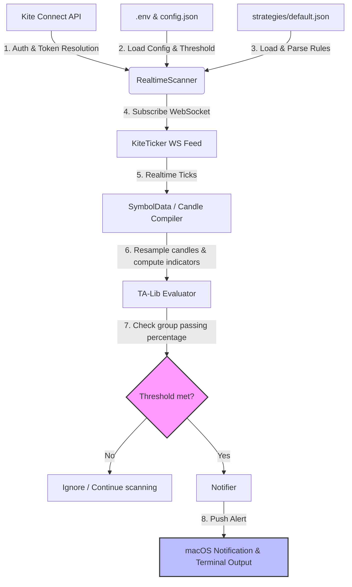

# Kite WebSocket Realtime Scanner (BasilTests)

A real-time technical analysis scanner built on top of **Kite Connect** and **TA-Lib**. The scanner subscribes to live stock market feeds via WebSockets, builds multi-interval candles (`1m`, `5m`, `15m`, `1h`, `4h`, `1d`) on-the-fly, evaluates sets of complex indicator conditions, and triggers threshold-based desktop notifications.

---

## Architecture & End-to-End Flow

Here is how the data flows through the application in real-time:



### Flow Step-by-Step:
1. **Startup & Resolution:** `scanner.py` reads `config.json` for target trading symbols (e.g. `NSE:RELIANCE`) and resolves them into numeric Kite `instrument_token`s.
2. **Historical Data Pre-fetch:** The scanner queries which intervals are needed by the active conditions (e.g. `5m`, `15m`, `1h`, `4h`, `1d`). It pre-fetches historical candles for each interval so that indicators (like MACD, Stochastic, or RSI) can be calculated immediately on the first tick.
3. **WebSocket Subscription:** The scanner establishes a connection via `KiteTicker` and subscribes to the full-depth ticks for all resolved symbols.
4. **Candle Compiling & Live Updates:** 
   * As ticks arrive, they are piped into `SymbolData`. 
   * It buckets ticks to form OHLC candles for active intervals.
   * The current forming candle is updated in real-time. The closing price is dynamically updated using the Last Traded Price (LTP), and the high/low values are adjusted if the LTP breaks the current range.
   * `4h` candles are resampled on-the-fly using `1h` candles.
5. **Grouped Condition Evaluation:** 
   * Every incoming tick updates candle OHLC and volume on the ingestion worker. Live chart events are published at most once per second per symbol (and immediately at candle rollover).
   * A separate worker evaluates all valid JSON strategies against shared private candle snapshots. Only the active strategy sends alerts. Provisional evaluations for the same symbol/candle are combined; final snapshots from earlier candles are retained. The rule panel displays the evaluation timestamp separately from the latest market update.
   * Desktop alerts are suppressed for evaluations more than ten seconds behind exchange time. The health endpoint reports pending tick batches and evaluations for monitoring processing load.
   * It counts the percentage of rules that evaluate to `True`.
6. **Threshold-Based Alerts:** 
   * The scanner loads `threshold` (e.g. `70` for 70%) from the active strategy JSON.
   * If the percentage of passing conditions $\ge$ `threshold`, it triggers a grouped alert.
   * The alert lists exactly which conditions passed and the stock's current price.
7. **Cooldown Filter:** The notifier applies a cooldown (e.g., 5 minutes) using a stable `cooldown_key` so that flickering condition counts do not cause alert spam. Desktop notifications use Notification Center on macOS, Windows notifications on Windows, and `notify-send`/libnotify on Linux; terminal output remains available when desktop notifications are unavailable.
8. **Dynamic Configuration Reload:** Every 5 seconds on incoming ticks, the scanner checks all strategy JSON profiles for changes. If files have changed, it reloads the conditions and its threshold on-the-fly without interrupting the live WebSocket connection.

---

## File Structure

* **`scanner.py`**: The central daemon process that connects to the WebSocket feed, manages historical data, aggregates candles, and runs the evaluation loop.
* **`conditions.py`**: Contains indicators utilizing `ta-lib` (e.g., MACD, RSI, ADX, Heikin-Ashi) and contains the natural-language condition parsers.
* **`notifier.py`**: Handles alert throttling (cooldowns) and triggers terminal printouts and macOS desktop notifications.
* **`../kite_runtime/auth.py`**: Shared Kite Connect authentication used by both Kite applications.
* **`tests/`**: Python regression tests and the Node dashboard test; run commands below from the repository root.
* **`config.json`**: List of symbols to track.
* **`update_futures_symbols.py`**: Requires a user-supplied `nifty200_futures_underlyings.json` list (not bundled); resolves those underlyings against Zerodha's live NFO instrument master and replaces `config.json` with exact near-month futures contracts. Run it after each monthly rollover.
* **`strategies/default.json`**: Multi-Timeframe Trend Confluence rules and alert threshold.

---

## Environment Setup & Installation

### 1. Prerequisites (macOS)
Since the python package `TA-Lib` depends on the underlying C-library `ta-lib`, you must install it first using Homebrew:
```bash
brew install ta-lib
```

### 2. Virtual Environment & Dependencies
From the parent `trading_alerts` directory, initialize your virtual environment and install the shared dependencies:
```bash
# Create virtual environment
python -m venv .venv

# Activate virtual environment
source .venv/bin/activate

# Install dependencies
pip install -r requirements.txt
```

---

## Configuration

### 1. Shared `.env` File
Configure the shared `trading_alerts/.env` file with the following variables:
```ini
KITE_API_KEY="your_api_key"
KITE_API_SECRET="your_api_secret"
KITE_ACCESS_TOKEN="your_access_token_after_auth"
```

### 2. `config.json`
Define the list of symbols you wish to scan:
```json
{
  "symbols": [
    "NSE:RELIANCE",
    "NSE:INFY",
    "NSE:SBIN",
    "NSE:TCS"
  ]
}
```

---

## Usage

### One-command startup (recommended)

From `trading_alerts`, run:

```bash
.venv/bin/python -m kite_runtime kite
```

One-time setup: in your Kite developer app, set **Redirect URL** to
`http://127.0.0.1:8765/callback`. Run the command on the same computer as your
browser. Keep `KITE_API_KEY` and `KITE_API_SECRET` in the shared root `.env`.
The launcher checks the saved access token; if it has expired, it opens Zerodha
login and waits up to five minutes for the local callback. Complete the browser
login and app-code step yourself. The request token is captured automatically,
exchanged, and the access token saved to `.env` without displaying it.

The command starts only the Kite dashboard and its alert scanner. Open
`http://127.0.0.1:8000` for the dashboard. Do not also start `scanner.py`.
Ctrl+C stops Kite. A valid token is reused on subsequent starts. If a token
expires while running, stop and rerun the command.

To start MTF alerts separately, use `.venv/bin/python -m kite_runtime mtf`.
Both applications share authentication through the `kite_runtime/` package.
Options: `--login` to force login and `--port 8001` to change the dashboard port.
The callback remains on port 8765.
If you keep a different developer-app redirect URL, use `--manual-auth` to paste
the redirect URL; saving the access token and starting services are still automatic.


### Live candlestick strategy dashboard

The dashboard and alert scanner share the same KiteTicker connection, candle
store and condition evaluator. Start it from the `kite` directory:

```bash
../.venv/bin/uvicorn dashboard:app --host 127.0.0.1 --port 8000
```

Open `http://127.0.0.1:8000`. The selected symbol receives live OHLC updates
over the local WebSocket. The chart switches between every strategy timeframe:
5-minute (EMA 20/50 and optional VWAP), 15-minute (Heikin-Ashi EMA 5/9),
1-hour (EMA 9/50), and daily (EMA 9/50). Opening-range and previous-day levels
are optional layers. Markers are confirmed only after a 5-minute rollover; the
side panel shows the still-forming strategy state.

Stop with one Ctrl+C. Shutdown drains active requests, stops Kite reconnects,
closes the ticker on its reactor thread and cancels the session finalizer and
pending dashboard broadcasts. Ticker/startup-thread cleanup waits are bounded.
The split dashboard does not rebuild unused historical combined-score plots.
Run shutdown regression checks from the repository root with
`.venv/bin/python -m unittest kite.tests.test_dashboard_shutdown kite.tests.test_live_dashboard`.

Kite supplies exact live VWAP through `average_price`. Its historical candle API
does not include VWAP, so pre-connection chart history uses a conventional
OHLC-volume reconstruction and switches to Kite's exact value on live ticks.

### 1. Authentication
To force a fresh login and start Kite, run from `trading_alerts`:
```bash
.venv/bin/python -m kite_runtime kite --login
```
Login captures the callback and saves `KITE_ACCESS_TOKEN` to the root `.env`
automatically. Add `--manual-auth` to paste a redirect URL or request token
if your developer app uses a different redirect URL.

### 2. Running the Scanner
To start the real-time scanning daemon:
```bash
python scanner.py
```

### 3. Running Unit Tests
From the repository root, verify parsing and indicator evaluations:
```bash
.venv/bin/python -m unittest kite.tests.test_parser
```
# Chart timestamp contract

The dashboard uses two synchronized charts: candles and price overlays above,
and strategy component studies below. Select ADX (14), OBV with EMA (5), or
Range / 5×ATR on 3m/5m; MACD on 15m; RSI on 1h/4h/1D.
Profile-specific studies take priority. When no profile study applies on 3m or
4h, these default chart studies remain available without adding strategy rules
or signals. Older saved charts missing these studies reconstruct them from
the saved candles for display; saved evaluations and marks stay unchanged. The lower chart uses its own
indicator units. Combined rule counts remain in the sidebar and confirmed
signals remain on the candle chart. Panning and zooming synchronize both
panels; missing values retain timestamp placeholders to preserve alignment.

Validate the dashboard with `node kite/tests/test_dashboard_ui.js`.

Chart timestamps are Unix seconds representing the original candle start instant;
the browser formats them explicitly in `Asia/Kolkata`, independently of its local
timezone. Daily candles display their trading date rather than a midnight trading
time. Historical API offsets are preserved when converting to market wall time.
KiteTicker's host-local naive datetimes are normalized at the SDK callback boundary.
No timestamp normalization changes OHLC values or aggregation rules.

The normal NSE equity session is 09:15–15:30 IST. Regular-session final starts are
15:25 (5m), 15:15 (15m), and 15:15 (1h); the final hourly interval is shortened
by the session close. These are normal-session conventions, not a holiday or
special-session calendar. Live candle construction excludes pre-open/post-close
updates and rejects out-of-order exchange ticks. The dashboard finalizes the last
observed candle at session close without constructing a synthetic candle; signals
are stored once per candle. Restart after upgrading to clear old in-memory
post-close candles and signals. Special trading sessions require an explicit
exchange calendar before use; feed connectivity alone does not mean market open.

The dashboard also supports a 3-minute chart with EMA 20/50 and optional VWAP, using historical 3-minute candles and live tick updates. Combined strategy signals continue to use the configured strategy timeframes.

### Saved session review (SQLite)

The scanner now records live rule evaluations for every loaded valid strategy
(normally every five seconds per symbol), alerts accepted by the notifier after cooldown, and confirmed 5-minute
candle states in `kite/data/history.sqlite3`. Each evaluation saves its rule texts,
pass/fail results, price, live VWAP, exchange timestamp, candle, and configured
threshold. Alerts and confirmed candle marks are separate: an intrabar alert can
fire without a directional signal at candle close. Desktop delivery can still fail
while a notifier alert is recorded.

Restart the application to enable recording. Select a symbol, choose **Review
date**, and click **Review saved day**. The chart loads saved candles and indicator
series; the session list contains evaluations and alerts. Select an entry to see
its saved rule results, or click a candle on its recorded confirmation timeframe to update both condition panels.
Clicking prefers the confirmed candle state, falling back to its last saved
evaluation. Candles without recordings show an explicit empty state. The selected
result stays visible while moving the mouse or leaving the chart. BULL/BEAR
marks appear on their recorded confirmation timeframe. **Return to live** resumes live display. Recording
continues for all configured symbols while reviewing a date.

History survives application restarts. Chart series are checkpointed once per
confirmation candle and again at session close, with up to 600 candles per timeframe for
indicator context. An abrupt stop may leave the last chart checkpoint incomplete;
individual committed evaluations remain available. The archive is local and is
not automatically deleted; monitor disk use, especially with many symbols.
Set `KITE_HISTORY_DB` to override the database path. Back up the database with
SQLite's backup API, or stop the application before copying it.

Only observations recorded after this upgrade are available. Missing sessions or
time while the scanner was stopped are not fabricated. Historical rule snapshots
are not rewritten when rule files change. Review is a record of live behavior,
not a historical backtest, trade execution log, or P&L calculation. Normal startup
still uses Kite authentication and symbol resolution.

### Multiple saved strategies

The **Strategy** selector and **Activate** button switch the scanner across all
symbols without reconnecting Kite. **Multi-Timeframe Trend Confluence** uses
`kite/strategies/default.json`, preserving all 14 bullish and 14 bearish rules
and the 90% threshold that was configured at migration. The scanner reads every
strategy from JSON. The old text files have been removed; `.env`
`ALERT_THRESHOLD` no longer controls strategy thresholds. Edit the JSON instead. Selection is remembered in
`kite/data/active_strategy.json`. Restart the application after this upgrade.

A second profile, **EMA trend (example)**, demonstrates the format; it is an
example rule set, not a recommendation. Add profiles as `kite/strategies/<id>.json`
using letters, numbers, underscores or hyphens for the ID:

```json
{
  "name": "My strategy",
  "threshold": 100,
  "cooldown_seconds": 300,
  "bullish": ["5-minute Close is above 5-minute EMA (20)"],
  "bearish": ["5-minute Close is below 5-minute EMA (20)"]
}
```

Profiles use the existing condition language. Both rule lists must contain strings;
one side may be empty. Invalid rules or thresholds reject activation. If history is unavailable for a symbol, activation still succeeds and its missing
intervals begin collecting live candles. Signals for that symbol remain suppressed
while any rule-required timeframe is empty; indicators also need their normal
lookback before their rules can pass. Terminal warnings include symbol, interval
and the history error. Invalid profiles and persistence failures still retain the
active strategy. Preparation pauses
evaluation while preserving the feed connection. Cooldowns default to `config.json`
when omitted and are isolated by strategy and rule version. Files are checked every
five seconds on incoming ticks; invalid edits retain the last working rules.

This version evaluates and records all valid strategies across all symbols. Only
the active strategy sends alerts. Live charts retain the standard studies; saved
review uses each strategy's recorded indicators. Confirmed markers use 5-minute
candle rollover. Other
custom Python evaluators and a visual rule editor are not
part of this version. All dashboard chart timeframes remain collected regardless
of the profile's rule intervals.

Evaluations and alerts carry the strategy name, ID and version. Existing database
records are migrated to `default`; the original records remain intact. Saved-day
review has a separate **Recorded strategy** selector. Selecting another recorded
profile does not change the active alert strategy. Changing rules does not rewrite saved snapshots. The history API
also accepts `strategy_id`; omitting it returns all strategies for compatibility.

Run all Kite regression checks from the repository root:

```bash
.venv/bin/python -m kite.tests -v
node kite/tests/test_dashboard_ui.js
```


### BTST profile

`strategies/btst_setup.json` adds **BTST Daily-Hourly Confluence**, matching the
seven buy conditions in the supplied PDF, plus the user-requested bearish
mirror. Each side requires all seven rules (100% threshold). MACD uses user-confirmed 12/26/9 periods. The exact rules are defined in `strategies/btst_setup.json`.
Restart after the parser upgrade, then
select and activate this profile. It is added without changing the saved active
strategy selection.


Strategy state is synchronized through the existing dashboard WebSocket; there is
no recurring `/api/strategies` HTTP polling. Page load and actual strategy changes
refresh the strategy list, and WebSocket reconnect checks for missed changes.
Refresh the page to discover newly added inactive profiles. Terminal `[STRATEGY]`
logs include startup state, activation/reload source, previous and new strategy,
threshold, rule counts and version. Invalid edits retain working rules and log
one warning per distinct error rather than repeating the warning every five seconds.


### Record all strategies and review after market close

Restart after this upgrade. All valid profiles present in `kite/strategies/` are
loaded at startup and evaluated during the session using the same feed and candle
snapshots. Evaluations, exact rule results, profile versions and confirmed 5-minute
states are saved for every strategy. Alerts and live strategy broadcasts remain
limited to the active profile. Switching the active strategy preserves the other
profiles' recording state and queued observations.

To compare recorded results, select a symbol and **Review date**, click **Review
saved day**, then select **Recorded strategy** in the session panel. This selector
loads that strategy's saved evaluations, alerts, bull/bear markers and indicator
series. It does not activate the strategy. The list comes from recorded data, so
profiles deleted from the strategy directory remain reviewable. Neutral confirmed
states are also retained; a neutral state has no directional marker. The alert list
contains only alerts actually accepted while that strategy was active.

Saved indicators reflect each profile's configured periods: for example, BTST
includes EMA(10), daily RSI with its band levels, hourly MACD(12,26,9), OBV with
EMA(11), and hourly volume versus the preceding three-candle maximum. Indicator
charts are checkpointed once per 5-minute candle and again at session close; an
abrupt stop can leave the last checkpoint incomplete. Mid-session edits retain
exact rule/version snapshots, while the chart checkpoint reflects the latest
recorded profile settings. Existing archives without strategy-specific charts use
their original shared chart checkpoint.

This records observations going forward, not a backtest. Old sessions are not
filled in for strategies that were not running. A newly added profile starts
recording after discovery (normally within five seconds of incoming ticks), with
no invented earlier observations. Invalid new files are excluded; invalid edits
retain the last working rules and produce a terminal warning. Removed inactive
profiles stop future recording, while their archive remains available.

Recording cost and disk usage increase with strategy count. Historical candles and
market subscriptions are shared, and the evaluation queue still combines redundant
provisional work per symbol/candle. Monitor processing errors and pending work in
`/api/health`, which also lists recording strategies and rejected profile errors.

### Historical request pacing

The live scanner uses one process-wide history request manager for startup and
strategy preparation. Requests start at least 0.5 seconds apart (at most two per
second), below Kite's documented three-per-second historical limit:
https://kite.trade/docs/connect/v3/exceptions/#api-rate-limit.
Rate-limit responses retry at most three total attempts, with increasing delays;
the backoff applies to the next request too. Other API errors are not retried.
Shutdown interrupts pacing/backoff waits.

Each symbol's interval initialization is locked, so startup and strategy activation
cannot independently initialize the same interval at the same time. Already
initialized intervals are reused; merging prepared history never overwrites an
interval that startup or live ingestion has populated in the meantime. Successful
responses have a bounded, in-memory cache (64 entries, up to 60 seconds), allowing
concurrent requests for the same token, timeframe and minute-normalized date window
to reuse data. This cache does not persist across application restarts.

The first warmup still needs a separate historical request per symbol/timeframe:
167 symbols and five intervals can require about 835 requests, taking roughly
seven minutes at two requests per second, plus network time and any backoff.
Strategies share these candles; adding another strategy using those intervals does
not multiply that history load. Live prices subsequently use KiteTicker ticks.
Startup progress is logged every 25 symbols; `/api/health` includes
`historical_requests` counters. This limiter covers this dashboard/scanner process,
not separately launched pattern scanners, MTF tools or other API clients.


### Strategy confirmation timeframe

A strategy whose candle rules all use one timeframe automatically confirms on
that timeframe. For example, a strategy with only `3-minute ADX (14) is greater
than 22 and rising` uses `3m` confirmation. Mixed-timeframe strategies and
strategies with only tick rules default to `5m`, preserving existing behavior.
Set `"confirmation_timeframe": "15m"` in a strategy JSON to override this default.
The dashboard offers `3m`, `5m`, `15m`, `1h`, `4h`, and `1d` chart tabs.
Tabs do not expand startup history requests or feed subscriptions. The `4h` chart
uses existing hourly candles.
The backend supports
confirmation intervals `1m`, `3m`, `5m`, `15m`, `30m`, `1h`, `4h`, and `1d`.
Each condition keeps its own calculation timeframe; marks are visible in the
dashboard when their confirmation interval has a matching chart tab.

Live scores and alerts can change while a candle forms. Confirmed marks use the
last evaluated state before the confirmation candle rolls over; the final observed
candle is finalized at the normal 15:30 session close after queued ticks and
evaluations finish. The final evaluation includes the last ingested tick, even
when the regular evaluation throttle skipped that tick. Startup history is never
recorded as a live observation before the first live tick. Hourly, 30-minute, and
4-hour buckets are anchored to 09:15; 4-hour candles are resampled from hourly
candles. These timings continue to assume a normal NSE session.

Markers and saved candle inspection follow each event's recorded confirmation
interval. Select that chart interval to see the marks and click its candles.
The dashboard displays the confirmation interval with the strategy results.
Previously saved records without interval metadata remain `5m`; changing a
strategy does not reinterpret old history. SQLite migrates the existing archive
automatically and separates confirmations on different intervals even when they
share a candle timestamp. No API credentials or additional dependencies are needed.
